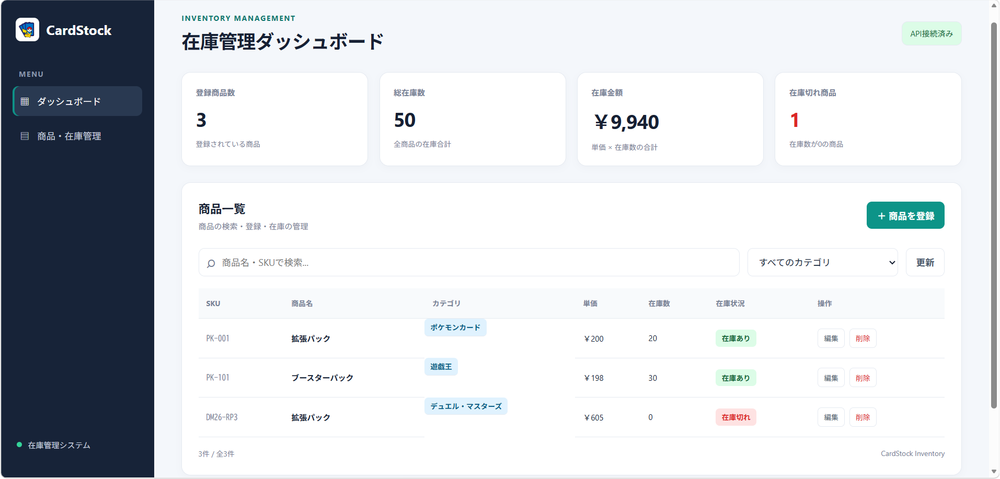
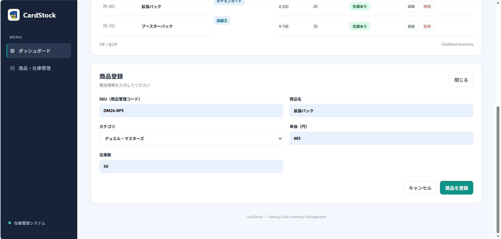
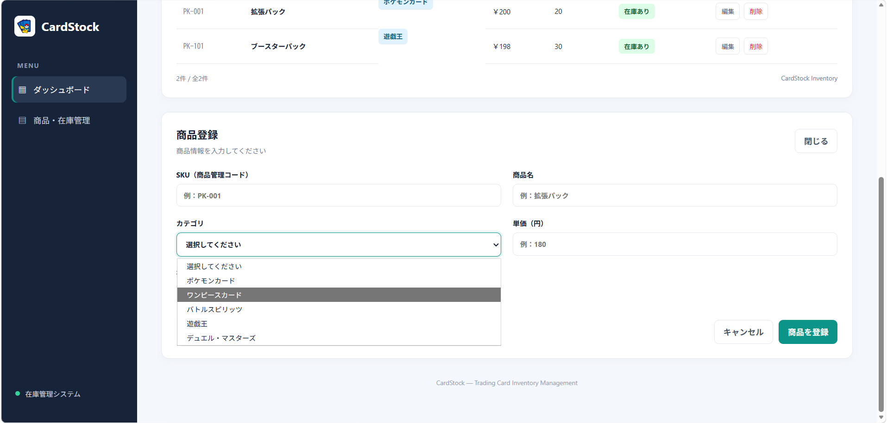

# CardStock --- TCG在庫管理システム
CardStockは、ポケモンカードやワンピースカードなど複数のカテゴリのトレーディングカードの在庫を管理するためのWebアプリケーションです。

Spring Bootを使用したバックエンドと、フロントエンドのHTML・CSS・JavaScriptを組み合わせて作成しました。







## 概要
**1. ダッシュボード**

登録されている商品や在庫の状況を一覧で確認できます。

- 登録商品数の表示
- 総在庫数の表示
- 在庫金額の表示
- 在庫切れ件数の表示

**2. 商品管理**

商品の登録から削除まで、基本的なCRUD機能を実装しています。

- 商品の新規登録
- 登録済みの商品の編集
- 商品の削除
- 商品コード(SKU)の重複チェック
- 商品カテゴリの管理
- 商品単価・在庫数の管理
- 商品名やSKUによる検索とカテゴリごとの絞り込み

## 使用技術

### フロントエンド
- HTML5
- CSS3
- JavaScript
- Fetch API

### バックエンド
- Java
- Spring Boot
- Spring Data JPA
- Hibernate
- MySQL

### 開発ツール
- VSCode
- MySQL
- Maven
- Git / GitHub

## データベースの設定
**1. データベースの作成**

MySQLに接続し、以下のSQLを実行してください。

```sql
CREATE DATABASE inventory_db
CHARACTER SET utf8mb4
COLLATE utf8mb4_unicode_ci;
```

**2. 接続設定**

src/main/resources/applicaton.propertiesにMySQLの接続情報を設定します。

```properties
spring.application.name=CardStock

spring.datasource.url=jdbc:mysql://localhost:3306/inventory_db
spring.datasource.username=${DB_USERNAME}
spring.datasource.password=${DB_PASSWORD}

spring.jpa.hibernate.ddl-auto=update
spring.jpa.show-sql=true
```
DB_USERNAMEとDB_PASSWORDには、使用するMySQLのユーザー名とパスワードを設定してください。

なお、spring.jpa.hibernate.ddl-auto=updateは、既存データベース内のテーブル構造を管理するための設定です。
データベース自体は事前に作成する必要があります。

## 動作環境
- JDK 25(Java 17+)
- Spring Boot
- Maven
- MySQL Server

## 実行方法
**1. リポジトリのクローン**

```bash
git clone https://github.com/motomasMINO/CardStock.git

cd CardStock
```

**2. アプリ起動**

Windowsの場合:
```bash
mvnw.cmd spring-boot:run
```
Mavenをインストールしている場合は、次のコマンドでも起動できます。
```bash
mvn spring-boot:run
```

**3. ブラウザでアクセス**

Spring Boot起動後、以下のURLにアクセスしてください。

http://localhost:8080

## APIエンドポイント
バックエンドでは、以下のエンドポイントを使用して商品情報を管理します。

| メソッド | エンドポイント | 処理 |
| ---------- | ---------- | ---------- |
| GET | /api/products | 商品一覧の取得 |
| POST | /api/products | 商品の新規登録 |
| PUT | /api/products/{id} | 商品情報の更新 |
| DELETE | /api/products/{id} | 商品の削除 |

**商品データのJSON形式**
```json
{
    "sku": "PK-001",
    "name": "拡張パック",
    "category": "POKEMON_CARD",
    "price": 180,
    "stockQuantity": 100
}
```
## 今後の改善予定
- 在庫数の増減履歴の管理
- 商品画像の表示
- 在庫数に応じたアラート機能

## ライセンス
このプロジェクトはMIT Licenseのもとで公開されています。

## お問い合わせ
- **GitHub: motomasMINO**
- **Email: yu120615@gmail.com**

バグ報告や改善点・機能追加の提案はPull RequestまたはIssueで受け付けています！